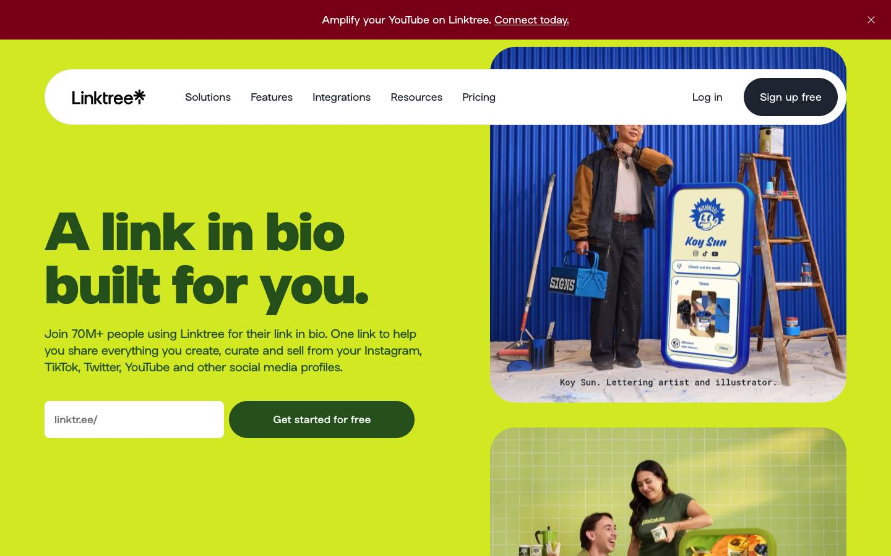
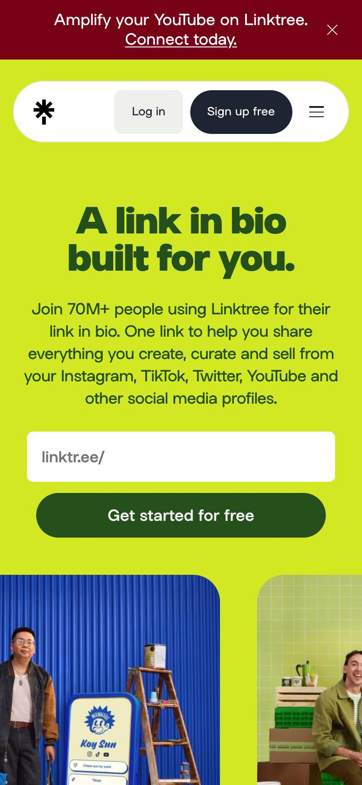

# Linktree — landing page teardown

> URL inspected: `https://linktr.ee/` · Captured 24 Nov 2026 · Desktop 1440×900 + mobile 390×844 (headless Chrome)
> Raw data: [`data/linktree.json`](data/linktree.json) · Tags: **[M]** measured · **[D]** derived · **[I]** inferred

| Desktop hero | Mobile hero |
|---|---|
|  |  |

Full page: [`shots/linktree-full-desktop.jpg`](shots/linktree-full-desktop.jpg)

## 1. One-line read

The concept is a "color-blocked brand poster". Every section is a different saturated full-bleed color with one huge heavy headline. That makes the scroll feel like flipping through magazine spreads. Each section has one idea and one CTA.

## 2. Stack

- Next.js App Router: `/_next/static` assets and `self.__next_f` are present **[M]**.
- Tailwind v4: `--color-*` tokens are written in `lab()`, `--tw-gradient-*` appears in transition lists, and container queries run from `20rem` to `42rem` **[M]**. Reading this as Tailwind v4 is **[I]**.
- Lottie and Rive resources load **[M]**. The phone mockups ship as Lottie with WebP posters (`/_marketing/lottie/posters/*-800w.webp`) **[M]**.
- Their keyframes include `accordion-down/up`, `overlay-in/out` and `content-in/out` **[M]**. That pattern matches Radix / shadcn **[I]**.

## 3. Typography

| Role | Font | Size / line-height | Weight | Tracking |
|---|---|---|---|---|
| H1 hero | **Link Sans** (custom variable, 300–900) | 80px / 85.6px | 800 | −1.6px (−0.02em [D]) |
| H2 section | Link Sans | 56px / 59.36px | 700 | −1.12px (−0.02em [D]) |
| H3 card | Link Sans | 28px / 36.4px | 500 | −0.28px |
| Lead paragraph | Link Sans | 18.18px / 27.27px | 400 | −0.36px |
| Body | Link Sans | 16px / 24px | 400 | normal |
| Small / meta | Link Sans | 13px / 19.5px | 400 | −0.169px |

All values above are **[M]**.

- Also declared: **DM Mono** (300/400/500), **Mencken Std Head Narrow** and **"ThatThat" pixel font** **[M]**. These are used for captions like "Koy Sun. Lettering artist and illustrator." (monospace caption under the hero image) **[M]** from the screenshot.
- On mobile, H1 → 37.44px / 40.06px and H2 → 27.3px **[M]**. That is about 0.47× of desktop **[D]**, so type scales fluidly rather than in fixed steps **[I]**.
- The headline line-height is tight (≈1.07 [D]). Combined with heavy weight and negative tracking, headlines read as dense "blocks".

## 4. Color system (section-by-section)

| Section | Background | Headline color | Notes |
|---|---|---|---|
| Promo bar | `#780016` maroon | white | Dismissible (×), underlined link |
| Hero | `#D2E823` lime | `#254F1A` forest green | CTA `#254F1A` pill |
| "Create and customize" | `#2665D6` blue | `#D2E823` lime | |
| "Share anywhere" | `#780016` maroon | `#E9C0E9` pink | |
| "Analyze your audience" | `#E8EFD6` pale sage | `#1E2330` ink | |
| Social proof / features | `#F3F3F1` warm off-white | `#1E2330` | Feature cards in pink, blue, navy `#061492` and gold `#D6A336` |
| FAQ | `#780016` | `#E9C0E9` | |
| Footer CTA | `#502274` purple | `#E9C0E9` | |

All colors **[M]**. Text ink is `#1E2330` and muted text is `#676B5F` (a warm, green-leaning grey) **[M]**.

The pattern is complementary pairs. Each section uses a background plus a contrasting headline hue taken from another section (lime on blue, pink on maroon), so the palette loops across the page **[D]**.

## 5. Layout and components

- **Nav:** a floating white pill bar that sits *inside* the hero, inset from the edges. It has a logo, 5 text links, "Log in" (ghost) and "Sign up free" (ink `#1E2330` pill) **[M]** from the screenshot and button probe. Nav links are 48px tall with a 16px radius and `0 16px` padding **[M]**.
- **Hero:** split layout. On the left: H1, a lead paragraph, a `linktr.ee/` **prefilled username input** and a "Get started for free" pill. On the right: tall rounded image cards (radius values on page include 32px and 64px **[M]**), each showing a creator photo plus a phone mockup.
- **Claim-your-username input** is the primary conversion pattern: a white input with the domain prefix, next to a dark pill CTA.
- Radius scale: `9999px` (68 uses), `16px` (48), `64px`, `32px`, `41.6px`, `24px`, `20px`, `8px` **[M]**. Pills dominate.
- Shadows are almost absent: 2 distinct values, e.g. `rgba(1,1,63,.1) 0 2px 19px -4px` **[M]**. Depth comes from color blocks, not shadows **[D]**.

## 6. Motion and micro-interactions

| Interaction | Value | Tier |
|---|---|---|
| Hero image "towers" | `home-hero-tower-up` / `home-hero-tower-left`, **30s ease-in-out infinite** | M |
| Section reveal / slide transforms | `transform 0.7s cubic-bezier(0.433, 0.217, 0.355, 1)` on 14 elements | M |
| Generic hover color | `color, background-color, … 150ms cubic-bezier(0.4, 0, 0.2, 1)` (Tailwind default) | M |
| CTA hover ("Sign up free") | bg `#1E2330` → `#262D3E` (lightens), 150ms `cubic-bezier(0, 0, 0.2, 1)` | M |
| CTA transition list | `background-color, transform, filter, box-shadow` 150ms | M |
| Nav panel | `nav-panel-slide-in/out`, `nav-panel-fade-in/out` keyframes | M |
| Other keyframes | `marquee`, `float`, `pulse`, `spin` | M |
| Video | `customise_your_linktree.webm`, muted, looping | M |

How it reads:

- The hero images drift in two directions on a slow 30s loop, so the hero always feels alive without being distracting **[I]**.
- The 0.7s custom curve starts slowly and lands softly. Reveals feel weighty, closer to editorial than snappy **[I]**.
- The CTA hover is subtle: a lift in lightness only, with no scale change detected within 600ms **[M]**.

## 7. Imagery

- **Real creator photography** is staged in colorful sets (blue corrugated wall, ladder, props). Each photo is paired with the creator's actual Linktree phone UI and a monospace caption naming the creator **[M]** from the screenshot.
- Phone mockups are animated Lottie with WebP poster fallbacks at 576px display size **[M]**.
- Logos for "As featured in…" and big brand tiles (HBO, Comedy Central) serve as social proof **[M]** from the full-page screenshot.

## 8. Breakpoints

`480 / 768 / 992 / 1280 / 1440 / 1920px`, plus max-width counterparts. Container-query steps run from 20rem to 42rem **[M]**. 991/992 is a Webflow-style breakpoint; it suggests part of the CSS came from an earlier Webflow build **[I]**.

## 9. What transfers / what doesn't

- **Transfers:** the full-bleed color-block rhythm, heavy tight headlines, the claim-username hero input, pills everywhere, almost no shadows, and slow ambient hero motion.
- **Doesn't transfer:** Link Sans is proprietary, and the lime/forest/maroon palette is Linktree's brand.
- **Not read:** Lottie JSON content, Rive state machines, and scroll-linked behavior beyond what `getAnimations()` returned at the sampled scroll positions.
