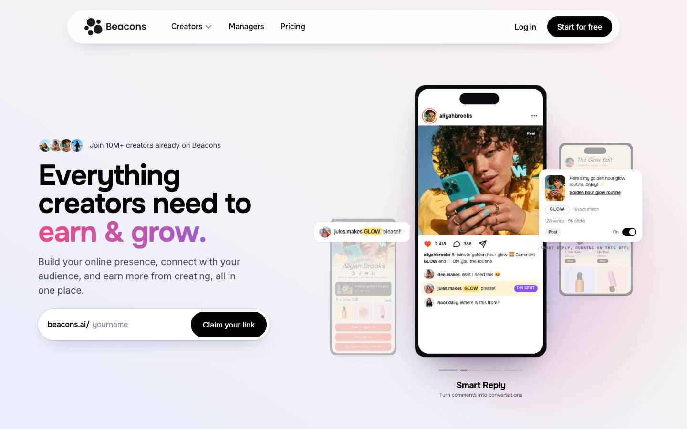
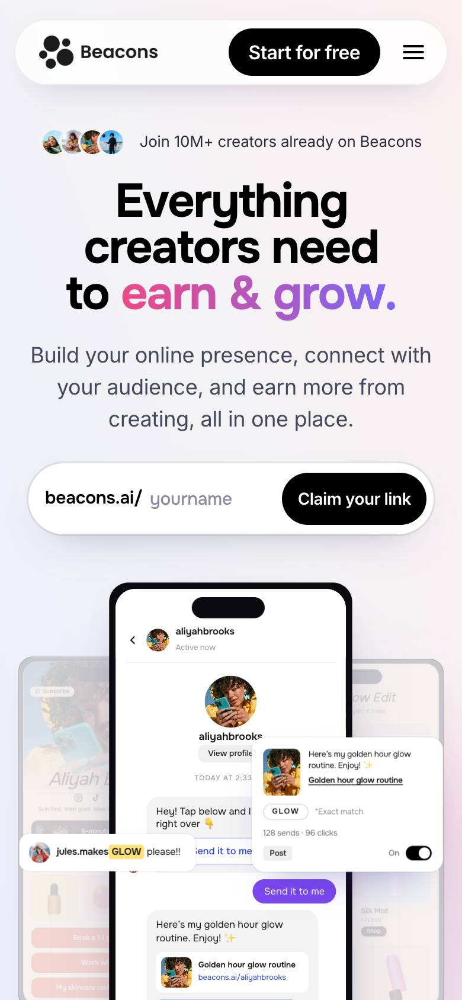

# Beacons — landing page teardown

> URL inspected: `https://beacons.ai/` · Captured 24 Nov 2026 · Desktop 1440×900 + mobile 390×844
> Raw data: [`data/beacons.json`](data/beacons.json) · Tags: **[M]** measured · **[D]** derived · **[I]** inferred

| Desktop hero | Mobile hero |
|---|---|
|  |  |

Full page: [`shots/beacons-full-desktop.jpg`](shots/beacons-full-desktop.jpg)

## 1. One-line read

Beacons looks like a modern SaaS product in a creator-economy coat. It uses a light lavender-to-blush gradient, a glassy floating nav, and **live product UI as the hero visual**: an Instagram post with comments where the keyword "GLOW" triggers an auto-DM. It has the richest micro-animation system of the six sites, with about 60 named keyframes.

## 2. Stack

- Next.js App Router **[M]**. Hand-written BEM-ish CSS with an `ms-` prefix (`ms-hx-*` for hero, `ms-bmx-*` for the Beam AI section) **[M]**.
- Rive runtime loads **[M]**.
- Fonts are self-hosted from `/i/fonts/` **[M]**.

## 3. Design tokens (exposed as CSS variables) [M]

```text
--font-headline: "Onest"       --font-sans: "Inter"
--font-mono: "IBM Plex Mono"   --font-decorative: "Patrick Hand"

--color-supernova:  #ee4985   (pink accent)
--color-orbit:      #7966f8   (violet accent)
--color-orbit-dark: #2740e7   (deep blue)
--color-spark:      #fffb29   (highlighter yellow)
--color-cloud:      #f3f3f5   (light surface)
--color-endlessness:#000      (primary / ink)
--color-body:       #616161   --color-border: #e0e0e0   --color-muted: #999

--color-endlessness-hover: color-mix(in srgb, #000 83%, #fff)
--color-orbit-dark-hover:  color-mix(in srgb, #2740e7 92%, #fff)

--gradient-lightbeam-light: linear-gradient(to top right, #8a8cf8, #a984dd 45%, #d371b8 75%, #f85994)
--gradient-stardust:        linear-gradient(to top right, #e8f2fe, #eff6ff 45%, #fff)
--gradient-galaxy:          linear-gradient(to top right, #080808, #202020 45%, #585858)
--radius-4/8/12/16/…
```

Hover states are generated with `color-mix()` rather than separate hand-picked hex values **[M]**. The result is one base color plus systematic hover variants **[D]**.

## 4. Typography

| Role | Font | Size / LH | Weight | Tracking |
|---|---|---|---|---|
| H1 | **Onest** (variable 400–800) | 60.48px / 59.27px | 700 | −1.81px (−0.03em [D]) |
| H2 | Onest | 64px / 73.6px | 700 | −1.92px (−0.03em) |
| H3 | Onest | 48px / 52.8px | 700 | −1.44px |
| Lead | Onest | 20px / 28px | 400 | −0.4px |
| UI / buttons | **Inter** (variable 400–700) | 16px / 20px | 600 | −0.32px |
| Eyebrow / labels | **IBM Plex Mono** | 10px / 10px | 500 | **+1px** |

All values **[M]**.

- IBM Plex Mono at 10px with +1px tracking is the most-used text style on the page (136 nodes) **[M]**. It appears in tiny uppercase "UI annotation" labels such as "SMART REPLY, RUNNING ON THIS REEL" **[M]** from the screenshot. This gives the page a technical, product-demo feel **[I]**.
- Accent words ("earn & grow.") use gradient text: `linear-gradient(90deg, #ee4985, #7966f8)` clipped to the text **[M]**.
- On mobile, H1 and H2 are both 40px **[M]**.

## 5. Layout and components

- **Nav:** `position: fixed`, a floating pill 20px from the top and 72px tall, with background `rgba(255,255,255,.8)` and **`backdrop-filter: blur(16px) saturate(1.4)`** **[M]**. After scrolling it carries the shadow `rgba(20,16,60,.35) 0 10px 30px -18px` **[M]**. The resting-state shadow was not isolated.
- **Hero background:** `linear-gradient(to right top, #E9ECFC 0%, #F3F3F5 55%, #FAF0F2 100%)` **[M]**. This is a cool lavender to blush wash **[D]**.
- **Hero glow:** a stack of three layers **[M]**:
  1. `radial-gradient(closest-side, violet/0.22, pink/0.10 55%, transparent)` with `filter: blur(18px)`.
  2. A `::after` with a `conic-gradient(transparent, pink/.55, violet/.55, transparent 60%)` and a mask, which forms a rotating ring.
  3. Animations `ms-hx-breathe` (9s) and `ms-hx-spin` (28s), both infinite.
- **Category tints:** per-feature colored blobs (`radial-gradient` + `blur(30px)`) in gold, violet, rose and amber, which crossfade at 900ms ease as the hero carousel changes "page/smart/store/kit" **[M]**.
- **Social proof row:** four overlapping 30px circular avatars plus "Join 10M+ creators already on Beacons" **[M]**.
- **Claim input:** a white pill holding `beacons.ai/` + `yourname` and a black "Claim your link" pill button (54px tall, 16px/24px padding) **[M]**.
- **Hero carousel:** segment indicators under the phone, with the caption "Smart Reply / Turn comments into conversations" **[M]** from the screenshot.
- **Card shadow signature:** `rgba(10,16,58,.6) 0 20px 40px -24px` (44 uses) **[M]**. The large negative spread keeps the shadow tight under the card, like a "floating paper" effect **[D]**.
- Radius scale: `999px` (175), `20px` (102), `50%`, `12px`, `16px`, `8px`, `24px` **[M]**.
- **Beam AI section:** dark `--gradient-galaxy` background with prompt-chip buttons. Each chip is `rgba(255,255,255,.04)` on dark, with a 1px `rgba(255,255,255,.12)` border and a 16px radius. The active chip gets a pink border `rgba(238,73,133,.7)` **[M]**.

## 6. Motion and micro-interactions

| Interaction | Value | Tier |
|---|---|---|
| Hero entrance | `ms-hx-up` **900ms `cubic-bezier(0.22, 1, 0.36, 1)`**, staggered: H1 0ms, paragraph 100ms, form 200ms | M |
| Hero phone cards drifting | `ms-hx-cardDriftA` 8.2s (delay 1.1s), `cardDriftB` 10.4s (delay 1.3s), infinite | M |
| Phone drift | `ms-hx-phDrift` at 7.4s, 8.1s, 8.6s and 9.4s, with easing `cubic-bezier(0.45, 0.05, 0.55, 0.95)` | M |
| Comment-to-DM demo | `ms-hx-dmIn`, `ms-hx-kwRow`, `ms-hx-sentIn`, `ms-hx-tapPulse`, `ms-hx-srIn` keyframes | M |
| "Built for 10M+ ___" rotating word | `ms-showcase-word` 16.8s `cubic-bezier(0.2, 0.8, 0.2, 1)` infinite, cycling "lofi producers. cozy gamers. booktok readers…" | M |
| Creator grid straighten on scroll | `ms-showcase-straighten` (44 tiles, `animation-duration: auto`) | M |
| Button hover | bg `#000` → `#2B2B2B` (color-mix 83%), `background-color, border-color, color 0.2s ease` | M |
| Prompt chips | `background-color, border-color, transform 0.25s ease` | M |
| Small UI toggles | `transform 0.2s / 0.28s cubic-bezier(0.2, 0.8, 0.2, 1)` | M |
| Tile translate | `translate 0.25s ease` (44 tiles) | M |
| Agencies logo marquee | `ms-agencies-scroll` | M |
| Skeleton / loading | `ms-skeleton-shimmer` | M |

How it reads:

- The entrance curve (0.22, 1, 0.36, 1) is an aggressive ease-out: most of the motion happens in the first third, then settles slowly **[D]**. Combined with the 100ms stagger, the headline, copy and form arrive as a cascade **[I]**.
- Using `animation-duration: auto` for `ms-showcase-straighten` points to a CSS **scroll-driven animation** (`animation-timeline`), with no JavaScript scroll listener **[I]**. The creator photo tiles start tilted and straighten as you scroll.
- The product demo is choreographed entirely with CSS keyframes: the comment appears, the "GLOW" keyword highlights in `--color-spark` yellow, and "DM SENT" pops in **[M]** (keyframe names plus the screenshot). That is why it feels like a real product rather than a static mockup **[I]**.

## 7. Imagery

- Creator photos in WebP from `cdn.beacons.ai/images/marketing_assets/` (`home-creator-*.webp`, 210×280 portrait tiles) **[M]**.
- The hero uses **constructed UI**, not screenshots: a phone with a real-looking IG post, floating cards for the DM flow, keyword chips and toggles **[M]** from the screenshot.
- Uniform portrait creator tiles on a violet gradient band (`#7966f8`) for the "Built for 10M+" section **[M]**.

## 8. Breakpoints

`810 / 900 / 1080 / 1200px`, plus small-screen steps at `380 / 520 / 560 / 600 / 760px` **[M]**. Values ending in `.98px` follow the min/max pairing technique that avoids sub-pixel gaps **[D]**.

## 9. What transfers / what doesn't

- **Transfers:** a token system with color-mix hovers, a glass floating nav, a staggered 900ms entrance, a choreographed CSS product demo, mono micro-labels, gradient accent words, and negative-spread shadows.
- **Doesn't transfer:** brand names (supernova/orbit) and the exact palette.
- **Not read:** the full frame-by-frame timing of the comment-to-DM demo (only the keyframe names and the timings that were running), and Rive asset contents.
