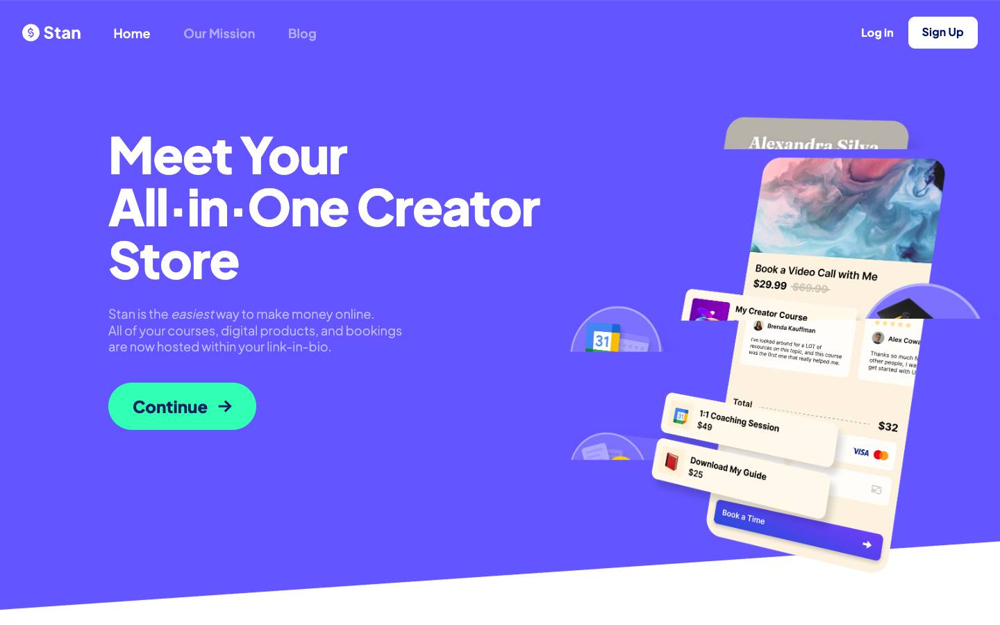
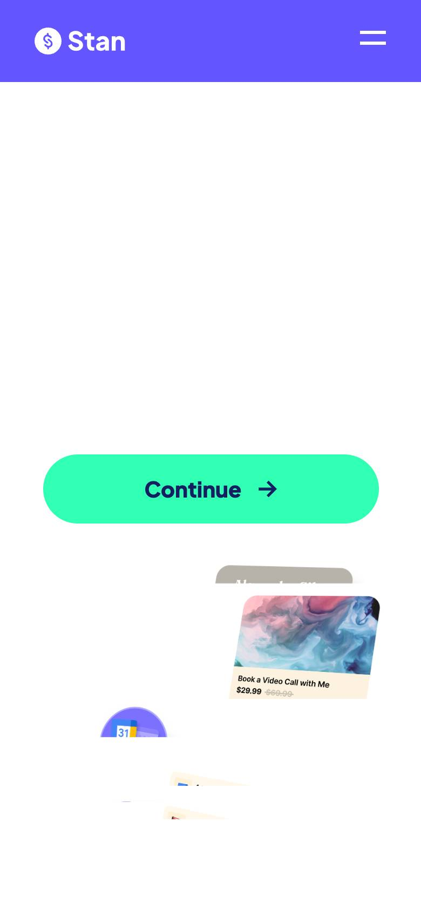

# Stan Store — landing page teardown

> URL inspected: `https://stan.store/` · Captured 24 Nov 2026 · Desktop 1440×900 + mobile 390×844
> Raw data: [`data/stan.json`](data/stan.json) · Tags: **[M]** measured · **[D]** derived · **[I]** inferred

| Desktop hero | Mobile hero |
|---|---|
|  |  |

Full page: [`shots/stan-full-desktop.jpg`](shots/stan-full-desktop.jpg)

## 1. One-line read

Stan is a "creator storefront checkout". A loud electric-violet hero with a mint CTA is followed by a long white page of creator proof, testimonials and price comparisons. It is the most conversion-copy-driven and least motion-driven page of the six.

## 2. Stack

- **Bootstrap 5**: a full `--bs-*` token set, plus `progress-bar-stripes`, `spinner-border` and `placeholder-glow` keyframes **[M]**.
- **Swiper** carousel (`swiper-icons` font, `swiper-preloader-spin`) **[M]**.
- A scoped keyframe hash (`landing-spin-3f3cf1c4`) suggests Vue single-file components with scoped styles **[I]**. The framework probe did not fire for Next, Nuxt or Astro **[M]**.
- Google Fonts **[M]**.

## 3. Typography

| Role | Font | Size / LH | Weight | Tracking |
|---|---|---|---|---|
| H1 hero | **Plus Jakarta Sans** | 72px / 75.6px | 800 | −1.5px |
| Hero sub | Plus Jakarta Sans | 18px / 23.4px | **300** | +0.05px, white 60% opacity |
| Section H1 | Plus Jakarta Sans | 32px / 38.4px | 900 | normal, with an emoji suffix ("🚀", "👀", "💰") |
| Stat ("0%") | Plus Jakarta Sans | 80px / 96px | 900 | normal |
| Feature H1 | Plus Jakarta Sans | 44px / 52.8px | 800 | normal |
| Body | Plus Jakarta Sans | 16px / 32px | 400 | +0.08px (loose 2.0 line-height [D]) |

All values **[M]**.

- Also loaded: Inter 300/400 **[M]**. Grobek (400/700) is declared in `@font-face` but was not in the loaded set **[M]**.
- Hero copy pairs weight 800 with weight 300 and uses an italic for emphasis ("the *easiest* way") **[M]** from the screenshot.
- "All·in·One" uses interpuncts as a brand typographic detail **[M]**.
- Mobile H1 is 36px / 43.2px **[M]**.

## 4. Color

| Role | Value |
|---|---|
| Hero / page background | `#6355FF` electric violet (set on `body`) |
| Primary CTA ("Continue") | `#30FFB4` mint, text `#131F60` navy |
| Nav "Sign Up" | white, text `#00106D`, 10px radius |
| Dark CTA ("Start My Trial") | `#131F60` navy pill |
| Body text | `#212529` (Bootstrap default) |
| Light sections | `#FFFFFF`, `#F8F7FA`, `#EEEEF9`, `#F2F4F8` |

All values **[M]**.

Violet plus mint is a near-complementary, high-energy pairing. The CTA is the only mint element in the hero, so it is the single brightest object above the fold **[D]**.

## 5. Layout and components

- **Hero:** a full-width violet band whose bottom edge cuts diagonally into white **[M]** from the screenshot. The mechanism behind the diagonal (clip-path, skewed pseudo-element or SVG) was not isolated.
- **Hero visual:** a phone-sized store card ("Book a Video Call with Me $29.99 ~~$69.99~~"), surrounded by floating product chips ("1:1 Coaching Session $49", "Download My Guide $25") and half-circle icon bubbles (Google Calendar) **[M]** from the screenshot.
- Hero image set: `stan-hero-1…8.png`, each 648×743 **[M]**. Eight stacked hero layers plus 40 `opacity 0.3s ease-in-out` transitions point to a crossfade sequence **[I]**.
- **CTA "Continue →":** a mint pill, 213×69, with 100px radius and `20px 35px` padding **[M]**. It is very large and very round.
- **Creator carousel ("The Best Creators Use Stan 🚀"):** portrait cards with a bottom scrim (`linear-gradient(0deg, rgba(0,0,0,.7), transparent)`) holding the name, @handle (white 60%) and a category chip ("💰 . Business Coach") **[M]**.
- **Testimonial wall:** a masonry of real social screenshots (TikTok comments, earnings screenshots such as "$8,986.38!") **[M]** from the full-page screenshot.
- **"0% Transaction Fees, Always."** is a giant stat with a hand-drawn circle **[M]** from the screenshot.
- **"A Simpler Solution 💰"** is a price-stack table: competing tools and prices are summed and struck against Stan's price **[M]** from the screenshot. This is a strong anchoring device **[I]**.
- Shadows are soft and very large: `rgba(0,0,0,.15) 0 50px 80px` and `rgba(0,0,0,.1) -10px 10px 30px` **[M]**.
- Radius scale: `10px`, `15px`, `40px`, `50px`, `9999px` **[M]**.

## 6. Motion and micro-interactions

| Interaction | Value | Tier |
|---|---|---|
| Image crossfades | `opacity 0.3s ease-in-out` (40 elements) | M |
| CTA buttons | `all 0.2s ease` | M |
| Nav button | `color, background-color, border-color 0.15s ease-in-out` | M |
| Hover on "Sign Up" / "Continue" | **no computed change** within 600ms | M |
| Entrance animations at load | **none returned** by `getAnimations()` | M |
| Scoped keyframes | `s-scale`, `s-fade`, `landing-spin` | M |

How it reads: Stan relies on composition and copy, not motion. The CTA hover gives no visible feedback, which is a gap compared with the other five sites **[D]**.

## 7. Imagery

- PNG composites of product UI cards in a tilted, layered arrangement **[M]**.
- Real creator portraits in the carousel, plus real social-proof screenshots in the testimonial wall **[M]**.
- A laptop-and-phone device mockup for "Not just another link·in·bio" **[M]** from the screenshot.

## 8. Breakpoints

Bootstrap: `576 / 768 / 992 / 1200 / 1400px`, plus custom `330 / 370 / 520 / 687 / 800 / 899 / 1048px` **[M]**.

## 9. What transfers / what doesn't

- **Transfers:** a single bright CTA color against a saturated hero, price-stack anchoring, a "0% fees" giant stat, emoji-suffixed section titles for a friendly tone, and the creator carousel with handle and category chip.
- **Avoid copying:** no hover feedback, PNG hero assets (heavy), and Bootstrap default text color.
- **Not read:** the diagonal-edge mechanism and the hero crossfade timing sequence.
