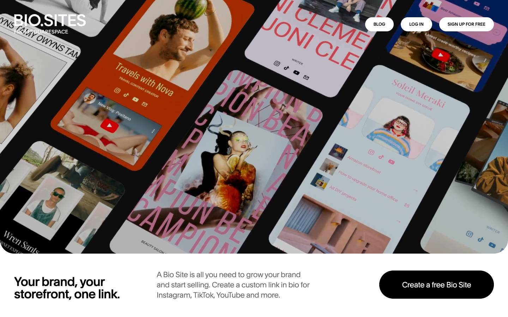
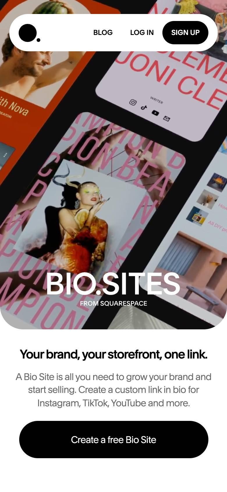

# Bio Sites (by Squarespace) — landing page teardown

> URL inspected: `https://biosites.com/` · Captured 24 Nov 2026 · Desktop 1440×900 + mobile 390×844
> Raw data: [`data/biosites.json`](data/biosites.json) · Tags: **[M]** measured · **[D]** derived · **[I]** inferred

| Desktop hero | Mobile hero |
|---|---|
|  |  |

Full page: [`shots/biosites-full-desktop.jpg`](shots/biosites-full-desktop.jpg)

## 1. One-line read

Bio Sites is a fashion-editorial look with Squarespace DNA. A full-bleed looping video of tilted template phones fills the hero, the type is restrained, everything is black and white, and the pills invert on hover. There are **zero box-shadows** on the page. The templates themselves supply all the color.

## 2. Stack

- Next.js with **CSS Modules**: class names like `index_heroTextContainer__jhn6x` and `FAQTab_answer__OCI0t` **[M]**.
- Assets come from `static.biosites.com/frontsitev2/` **[M]**. Consent is handled by TrustArc **[M]**.
- No `:root` tokens were exposed **[M]**. Styles are module-scoped.

## 3. Typography

| Role | Font | Size / LH | Weight | Tracking |
|---|---|---|---|---|
| Hero H1 (white strip) | **Clarkson** | 35px / 35px | 500 | −1px |
| Sticky-scroll words ("STAND OUT", "SELL", "CONNECT", "ANALYZE") | Clarkson | 70px / 70px | 500 | −2px |
| Big display alternative | Clarkson | 55px | 500 | −2px |
| Section H2 | Clarkson | 18px / 25.2px | 400 | −0.5px |
| FAQ question | Clarkson | 21px / 29.4px | 400 | −0.5px |
| Body / UI | Clarkson | 16px / 17.6px | 400 | −0.5px |
| Nav pills | Clarkson | 12px | 500 | uppercase |

All values **[M]**.

- Also declared: **Canela** Light, Canela Light Italic and **Canela Text** (editorial serifs) **[M]**. They are used where templates show serif names ("Soleil Meraki", "Wren Santi") **[I]**.
- The H1 is only 35px. The headline is deliberately quiet because the hero video carries the impact **[D]**.
- The whole page uses consistent negative tracking (−0.5px on body text).

## 4. Color

- Page base: `body` is black (`#000`), with white text (198 nodes) and `#6A6A6A` grey **[M]**.
- UI is strictly monochrome: white pills, black CTA, and an `#FAFAFA` FAQ section **[M]**.
- Template accent colors (only inside template cards): `#0300DC`, `#FE014B`, `#79A1FB`, `#00FFD1`, `#881975`, `#05243E`, `#515A2D` **[M]**.

## 5. Layout and components

- **Hero:** a full-bleed `<video>` (`videos/hero/loop.mp4`, WebP poster, muted, looping) at `filter: brightness(0.8)` **[M]**. Over it sits a top gradient mask `linear-gradient(#111 -39%, transparent 49%)` that keeps the logo and nav legible **[M]**. The hero's bottom corners are rounded (radius values include `0 0 40px 40px`) **[M]**.
- **Logo:** "BIO.SITES / FROM SQUARESPACE" in white, top-left. An element uses **`mix-blend-mode: difference`** **[M]**, so it inverts against whatever sits behind it **[D]**.
- **Nav:** three white pills ("BLOG", "LOG IN", "SIGN UP FOR FREE"). Each is 40px tall with a 40px radius and `0 24px` padding, in 12px weight-500 uppercase type **[M]**.
- **Value strip:** a white band split into three columns: H1 | description | big black CTA. The CTA "Create a free Bio Site" is 325×80 with a 46px radius and 21px text **[M]**.
- **Sticky scroll storytelling:** a phone on the left of a pastel gradient panel, with four giant words stacked in a column. The active word is dark and the inactive words are pale lilac **[M]** from the full-page screenshot. Each step has its own video (`01-stand-out.mp4`, `02-earn.mp4`, `03-connect.mp4`, …) **[M]**.
- **Template marquee:** cards 205×423 with radius `20px 20px 0 0` (rounded tops only) **[M]**. Each card carries a "Get started ↗" glass button: `rgba(0,0,0,.25)` with **`backdrop-filter: blur(50px)`** and a 46px radius **[M]**. Alt text describes each template's persona ("Bold, typographic Bio Site template for an artist.") **[M]**.
- **FAQ:** a long accordion on `#FAFAFA`.

## 6. Motion and micro-interactions

| Interaction | Value | Tier |
|---|---|---|
| Hero text entrance | `index_fadeInUp` 1s ease | M |
| Hero underline / line | `index_slide` 2.5s ease | M |
| Template carousel | `index_move` **100s linear infinite** (continuous marquee) | M |
| Sticky-scroll copy swap | `transform 0.5s ease-in-out`, **300ms delay** | M |
| Stacked-word opacity | `opacity 0.5s ease-in-out` | M |
| Nav pill hover | **inverts**: white → black bg, black → white text, `background-color, color, border 0.3s linear` | M |
| Main CTA hover | **inverts**: black → white bg, text → `#010101`, border → `#E6E6E6`, 0.3s linear | M |
| Template button | `all 0.2s ease-out` | M |
| FAQ open | answer `FAQTab_fadeInUp` 0.4s ease; container `height, margin 0.2s ease` | M |

How it reads:

- Hover is a full color inversion over 300ms linear, a fashion-brand idiom. Because the transition is linear, the color flip feels even and mechanical **[D]**.
- The 100s marquee is slow enough to read as a gallery wall rather than a ticker **[I]**.
- The 300ms delay on the sticky copy lets the video change first and the text follow **[D]**.

## 7. Imagery

- **Video-first:** the hero loop plus one video per storytelling step **[M]**.
- Template screenshots in WebP with descriptive alt text **[M]**. Real photography sits inside each template (fashion, food, travel).
- The hero shows tilted phones in a diagonal grid, which creates depth without any shadow **[M]** from the screenshot.

## 8. Breakpoints

The stylesheet walk returned no media queries **[M]**. The CSS Modules sheets were readable, but the breakpoints may be applied through JavaScript or through sheets the walk missed. Treat this as **unknown**. The mobile layout does reflow: H1 becomes 21px and the sticky words become 46px **[M]**.

## 9. What transfers / what doesn't

- **Transfers:** a video hero with a gradient legibility mask, a monochrome UI that lets user content carry the color, invert-on-hover pills, a glass button on imagery, a slow template marquee, and sticky-scroll storytelling.
- **Doesn't transfer:** Clarkson and Canela are licensed typefaces, and the Squarespace brand.
- **Not read:** breakpoints (see above) and the sticky-scroll trigger mechanism.
