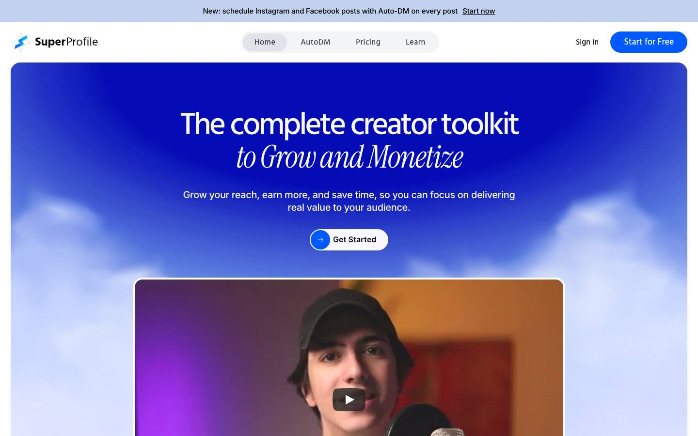
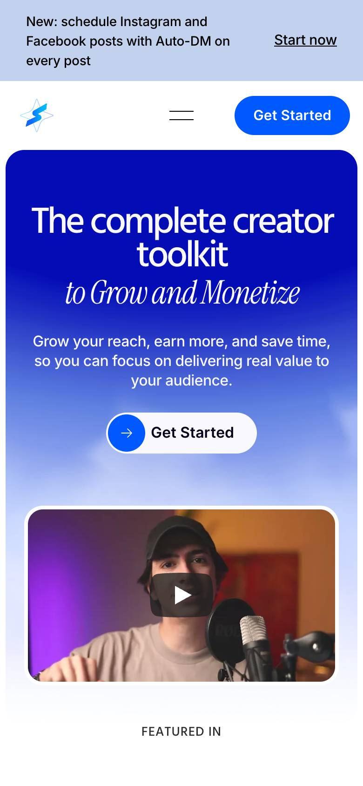

# SuperProfile (India) — landing page teardown

> URL inspected: `https://superprofile.bio/in` · Captured 24 Nov 2026 · Desktop 1440×900 + mobile 390×844
> Raw data: [`data/superprofile.json`](data/superprofile.json) · Tags: **[M]** measured · **[D]** derived · **[I]** inferred

| Desktop hero | Mobile hero |
|---|---|
|  |  |

Full page: [`shots/superprofile-full-desktop.jpg`](shots/superprofile-full-desktop.jpg)

## 1. One-line read

SuperProfile is a polished Framer SaaS page aimed at Indian creators. A rounded sky-blue hero card with clouds holds a sans and italic-serif headline pair and a video demo. Below it come segmented tabs, feature bento cards, an integration orbit and a video testimonial wall. Smooth scrolling (Lenis) and spring easing make it feel premium.

## 2. Stack

- **Framer**: `<meta name="generator" content="Framer 68244df">`, `framerusercontent.com` assets and `framer-*` classes **[M]**.
- **Lenis** smooth scrolling **[M]**. Styled-components class names (`sc-*`) **[M]**.
- Framer design tokens are exposed as `--token-<uuid>` (for example `#1c64ff` blue, `#f9f8ff`, `#272b2d`) **[M]**.

## 3. Typography

| Role | Font | Size / LH | Weight | Tracking |
|---|---|---|---|---|
| H1 line 1 | **Hind Madurai** | 65px / 58.5px | 500 | **−3.9px (−0.06em [D])** |
| H1 line 2 (accent) | **Instrument Serif** *italic* | 65px / 65px | 400 | −1.95px (−0.03em) |
| H2 social proof | Instrument Serif | 48px / 60px | 400 | −0.96px |
| H2 FAQ | Hind Madurai | 56px / 67.2px | 400 | −0.56px |
| Final CTA | Hind Madurai | 80px / 80px | 700 | normal |
| Feature H3 | Hind Madurai | 30px / 36px | 700 | normal |
| Body | Hind Madurai | 20px / 28px, 17px / 25.5px | 400 | normal |
| Small UI | Inter | 14px / 22.4px | 400 | normal |

All values **[M]**.

- **The signature move is a sans headline plus an italic-serif accent line**: "The complete creator toolkit / *to Grow and Monetize*", repeated as "*Reach more people* with tools built for growth" and "*Drive more revenue*…" **[M]** from the screenshots.
- The H1 line-height is below 1 (0.9 [D]) and tracking is very tight (−0.06em). The sans line reads as a compact slab **[D]**.
- Hind Madurai covers Tamil script as well as Latin, a plausible India-first choice **[I]**.
- Mobile H1 is 40px, with the serif line at 35px **[M]**.

## 4. Color

| Role | Value |
|---|---|
| Primary CTA | `#0059FF` |
| Brand token blue | `#1C64FF` |
| Announcement bar | `#C2D1ED` |
| Nav segmented track | `#F0F1F2`; active tab `#D8DDE3`; hover `#DFE3E8` |
| Hero text | `#F9F8FF` on a deep-blue sky |
| Ink | `#16101E` (a near-black with a violet tint) |
| Section washes | `#F7F9FA`, plus a `linear-gradient(135deg, #F7FCFB …)` mint wash |
| Decorative blob | `linear-gradient(90deg, #00A1FF, #3269FF 30%, #7632FF 71%, #C832FF)` at **`blur(270px)`** |
| Integration glows | `radial-gradient(50% 50%, <brand-color>/0.25, transparent)` in orange, blue, green, magenta, violet and red |

All values **[M]**.

## 5. Layout and components

- **Announcement bar:** full width, 45px, "New: … Start now" link **[M]**.
- **Nav:** logo on the left, a **segmented pill tab group** in the center (Home / AutoDM / Pricing / Learn; 37px tall, `8px 24px` padding, 999px radius), and "Sign In" text plus a blue "Start for Free" pill (48px radius, 44px tall) on the right **[M]**.
- **Hero card:** inset from the page edges with a 20px radius, built from a sky-and-clouds image (`1397×1029` PNG) with a deep-blue top **[M]**. A YouTube demo video sits inside a white-bordered rounded frame **[M]** from the screenshot.
- **"Get Started" CTA:** a light pill (`#F9F8FF`) with a **blue circular arrow icon on the left** (padding `0 24px 0 48px`) **[M]**.
- **Logo strip:** a marquee with an edge fade mask, `linear-gradient(to right, transparent 0%, #000 12.5%, #000 87.5%, transparent)` **[M]**.
- **Feature sections:** a dark textured band with three bento cards (AutoDM, Link-in-Bio, Lead Magnets), then a horizontal tab bar (Digital Products, Courses, …) above a product preview **[M]** from the screenshot.
- **Workflow diagram:** nodes connected by lines, plus a "5X" stat callout **[M]** from the screenshot.
- **Integration orbit:** app icons in concentric rings with colored radial glows **[M]**.
- **Testimonial wall:** a masonry of video tiles (`framerusercontent` mp4, autoplay, muted, looping, 384px wide) and WhatsApp/DM screenshots **[M]**.
- **Shadows:** Framer-style **layered shadows** with 4–5 stacked layers, e.g. `rgba(0,0,0,.1) 0 1px 3px, rgba(0,0,0,.09) 0 6px 6px, rgba(0,0,0,.05) 0 13px 8px, rgba(0,0,0,.01) 0 22px 9px …` **[M]**. This gives realistic, soft depth **[D]**.
- Radius scale: `16px` (29), `12px` (28), `14px`, `10px`, `20px`, `100px`, `48px`, `999px` **[M]**.

## 6. Motion and micro-interactions

| Interaction | Value | Tier |
|---|---|---|
| Smooth scroll | Lenis | M |
| Text reveal | WAAPI on ``s, **2800ms**, spring-generated `linear(…)` easing, staggered 200ms → 250ms | M |
| Logo marquee | WAAPI on `<ul>`, **77.32s linear infinite** | M |
| H1 decoration | styled-components keyframe `eKXFfL` 6s linear infinite | M |
| Nav tab hover | bg `#F0F1F2` → `#DFE3E8` (Framer animates in JS, so CSS transition reads `0s`) | M |
| Footer icons | `fill, fill-opacity 0.1s` | M |

How it reads:

- The `linear()` easing is a sampled spring curve: 50% of progress is reached at about 6% of the duration, and the remaining 94% is a long settle **[D]**. Words snap in, then glide to rest, which is the typical Framer "spring" feel **[I]**.
- Hover feedback is instant color swaps driven by Framer's JavaScript; there are no CSS transitions to read **[M]**.
- What `eKXFfL` animates on the H1 (likely a shimmer or gradient) was not extracted **[I]**.

## 7. Imagery

- Hero: a sky/cloud background photo with a talking-head video thumbnail (YouTube `sddefault.webp`) **[M]**.
- Product UI shown in phone frames inside bento cards **[M]**.
- Indian creator faces and WhatsApp-style chat proof in testimonials **[M]** from the screenshot, which fits the local market.
- Logos and badges as PNGs from `framerusercontent` **[M]**.

## 8. Breakpoints

Framer's three: `810px` and `1200px` (plus `1440px` max) **[M]**. The mobile page is 16,503px tall versus 9,678px on desktop **[M]**. Sections stack heavily on mobile **[D]**.

## 9. What transfers / what doesn't

- **Transfers:** the sans plus italic-serif headline pairing, segmented nav tabs, an inset rounded hero card, an icon-leading CTA pill, the masked-edge logo marquee, layered soft shadows, spring text reveals, and an India-relevant proof style (WhatsApp, rupee pricing).
- **Watch out:** Framer-only JS animation (rebuild with Motion/CSS), and very long mobile pages.
- **Not read:** the `eKXFfL` keyframe body, Framer variant timings, and Lenis configuration (lerp/duration).
