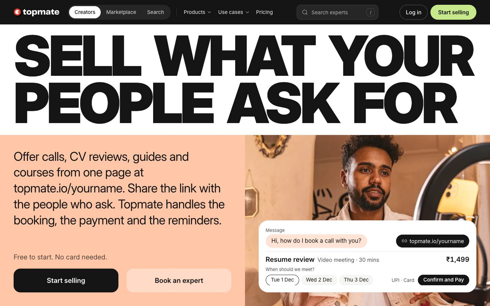
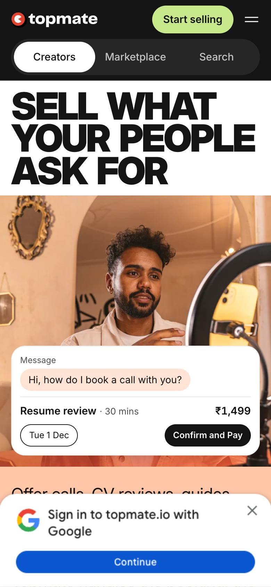

# Topmate — landing page teardown

> URL inspected: `https://topmate.io/` · Captured 24 Nov 2026 · Desktop 1440×900 + mobile 390×844
> Raw data: [`data/topmate.json`](data/topmate.json) · Tags: **[M]** measured · **[D]** derived · **[I]** inferred

| Desktop hero | Mobile hero |
|---|---|
|  |  |

Full page: [`shots/topmate-full-desktop.jpg`](shots/topmate-full-desktop.jpg)

## 1. One-line read

Topmate uses **brutalist editorial confidence**. A 162px black uppercase headline spans the full width, followed by warm peach/cream/lime blocks, real photography with an overlaid booking UI in rupees, and a very disciplined motion system built on a single easing curve. It is the strongest India-first reference of the six.

## 2. Stack

- Next.js App Router **[M]** with **Tailwind v4**: breakpoints `40rem / 48rem / 64rem / 80rem / 96rem` **[M]**.
- **Ant Design** keyframes (`css-1yqcsqt-ant*`) **[M]**, likely from the app shell or forms **[I]**. A **Swiper** keyframe is present **[M]**.
- Section-scoped keyframe prefixes (`TEjSPq_offerPop`, `uQDgrq_gradientFlow`, `S_NwIW_adm-drift`) suggest CSS Modules for each section **[I]**.
- Images are served from `/_next/static/immutable/media/*.webp` **[M]**.

## 3. Typography

| Role | Font | Size / LH | Weight | Tracking |
|---|---|---|---|---|
| H1 | **Inter** ("Inter v3") | **162px / 139.32px** | **900** | **−7.29px (−0.045em [D])**, UPPERCASE |
| H2 stat | Inter | 76px / 79.42px | 600 | −3.04px (−0.04em) |
| H2 section | Inter | 56px / 60px | 500 | −1.68px (−0.03em) |
| Big statement | Inter | 64px / 73.6px | 400 | −1.28px (106 nodes, word-split for animation [I]) |
| H3 feature | Inter | 32px / 38px | 600 | −0.64px |
| Lead | Inter | 28px / 40px | 500 | −0.56px |
| Body | Inter | 20px / 28px, 16px / 24px, 14px / 22px | 400 | normal |
| Nav | **Inter Nav** (variable 400–900) | 15–16px | 500–600 | normal |

All values **[M]**.

- One family, many weights. The hierarchy comes from scale contrast (162 → 14px) and weight, not from font pairing **[D]**.
- H1 line-height is 0.86 [D], so lines nearly touch. That is the poster effect.
- Gilroy (400–800) is declared but was not observed in use **[M]**.
- Mobile H1 is 54px / 46.44px, still uppercase weight 900, wrapping to three lines **[M]**.

## 4. Color

| Role | Value |
|---|---|
| Ink / dark sections / nav | `#141414` |
| Paper | `#FFFFFF`, warm `#F7F5F3` |
| Primary CTA | **`#C7E98C` lime**, hover `#B8E574` |
| Hero lower band | `#FFC6A8` peach; secondary button `#FFE4D6` |
| Cream band | `#F8EEDB` |
| Payments section | `#C7E98C` lime full-bleed; light lime `#DCF1B6` |
| Neutrals | `#EBE9E4`, `#EBE9E0`, `#2A2927` |
| Text on dark | `rgba(245,244,240,.65)` muted, `#F5F4F0` strong |
| Text on light | `#141414`, plus 75%/70%/30% alpha steps |

All values **[M]**.

The palette is warm and natural: off-blacks and off-whites with a slight warm tint, rather than pure `#000` and `#fff` **[D]**. Text hierarchy uses **alpha steps of the ink color** (100/75/70/30%) instead of separate greys **[M]**.

## 5. Layout and components

- **Header (dark, 72px):** logo, then a **segmented pill switcher** (Creators active as a white pill / Marketplace / Search), then a divider, then dropdowns (Products, Use cases) and Pricing, then a search input with a `/` keyboard-shortcut hint, then "Log in" (1px `rgba(255,255,255,.3)` outline pill) and "Start selling" (lime pill) **[M]**.
- **Hero:** the H1 runs edge to edge on white. Below it is a **two-column split**: a peach column with a large lead paragraph, "Free to start. No card needed." and two big buttons (black "Start selling" / peach "Book an expert"), next to a full-bleed photo of a creator at a ring light **[M]** from the screenshot.
- **Overlaid product UI on the photo:** a white card holding a message bubble ("Hi, how do I book a call with you?"), a `topmate.io/yourname` link chip, "Resume review · Video meeting · 30 mins **₹1,499**", date chips (Tue 1 Dec / Wed 2 Dec / Thu 3 Dec), "UPI · Card" and a black "Confirm and Pay" pill **[M]** from the screenshot. **This one card explains the whole product.**
- **Big stat:** "Topmate has paid ₹100+ crore to creators." **[M]**
- **Offer tabs:** Meetings / Webinars / Cohorts / Courses / Digital Products / Packages / Priority DM / Memberships, with an **auto-advancing progress bar** (`spot-fill` 5s linear on `.spot-prog`) **[M]**. Reading it as an auto-rotating spotlight is **[I]**.
- **Feature cards:** Zoom Pro, Calendar sync, Reminders, Testimonials, each with a 28px radius **[M]**.
- **Dark mega-section (`#141414`, ~6,700px tall):** "You bring the people. Topmate turns them into bookings." It contains marketing tools, cohorts, testimonials ("In their words.") and an FAQ **[M]**.
- **Final CTA:** "When people ask, send your link." **[M]**
- **Shadows: none** (0 distinct values) **[M]**. Depth comes only from color blocks and photography.
- Radius scale: `999px` (84), `28px` (42), `12px` (37), `18px` (32), `8px` (27) **[M]**.

## 6. Motion and micro-interactions

**Signature easing: `cubic-bezier(0.25, 1, 0.5, 1)`** (an ease-out-quart shape [D]) is used for nearly everything **[M]**.

| Interaction | Value | Tier |
|---|---|---|
| Button hover/press | `transform 0.4s cubic-bezier(.25,1,.5,1)` → **`scale(0.97)`** on hover; bg `#C7E98C` → `#B8E574` 0.2s ease | M |
| Rolling text (`.roll`) | per-span WAAPI: **500ms `cubic-bezier(.25,1,.5,1)`** paired with a 175ms linear fade; vertical edge mask `linear-gradient(transparent, #000 5px, #000 calc(100% - 5px), transparent)` | M |
| Accordion (FAQ) | **`grid-template-rows 0.4s`** with the signature curve (16 elements) | M |
| Expanding elements | `padding 0.4s`; `max-width, margin 0.4s + opacity 0.2s` | M |
| Icons | `stroke` / `fill 0.26s cubic-bezier(0.5, 0, 0.1, 1)` (242 SVG nodes) | M |
| Nav tabs | `color 0.2s` with the signature curve | M |
| Offer spotlight progress | `spot-fill` 5s linear (`spot-in` / `spot-out`) | M |
| Section keyframes | `offerPop`, `offerRise`, `sparkle`, `gradientFlow`, `arrowBob`, `adm-drift`, `adm-shift`, `scrollUp/DownAnimationStorefront` | M |
| Micro | `opacity 0.12s linear` | M |

How it reads:

- **Hover shrinks the button to 0.97** instead of lifting it, so hovering already feels like pressing **[D]**. With a 400ms ease-out-quart curve the shrink starts fast and settles softly **[D]**.
- The rolling text works by sliding words vertically inside a masked line; the 4–5px mask fades the edges so letters don't hard-clip **[D]**. The result is an odometer / slot-machine word swap **[I]**.
- Animating `grid-template-rows` from `0fr` to `1fr` is the modern CSS way to transition an accordion to its content height without measuring it in JavaScript **[I]** (the from/to values were not captured).
- One shared curve across buttons, tabs, accordions and text gives the whole site a single motion "voice" **[D]**.

## 7. Imagery

- **Warm, real lifestyle photography** of Indian creators and mentors: a ring-light studio, a long-table mentoring session (Pexels stock, `meetings-mentor-client-call-pexels-7245802`) **[M]**.
- Creator portraits in WebP, **`loading="lazy"`** below the fold and **eager** for the hero **[M]**.
- Descriptive alt text ("A man records a video in front of a ring light") **[M]**.
- Photo plus floating UI card is the dominant composition pattern.

## 8. Breakpoints

A dense set: Tailwind v4 rems plus legacy `374 / 480 / 576 / 600 / 768 / 992 / 1024 / 1200 / 1280 / 1360 / 1400 / 1600px` **[M]**.

On mobile, a Google One Tap sign-in sheet appears on load **[M]** from the mobile screenshot.

## 9. What transfers / what doesn't

- **Transfers:** a giant uppercase poster headline, one font family with scale contrast, warm off-black/off-white plus lime and peach, alpha-step text hierarchy, a photo with a product-UI overlay showing **₹ pricing and UPI**, a single easing curve, scale-down hover, rolling text, grid-rows accordions, no shadows, and an auto-advancing offer tabs progress bar.
- **Doesn't transfer:** Topmate's exact lime/peach brand combo and copy voice.
- **Not read:** the keyframe bodies for `offerPop`, `gradientFlow` and the others, and the scroll-trigger logic for word rolls.
